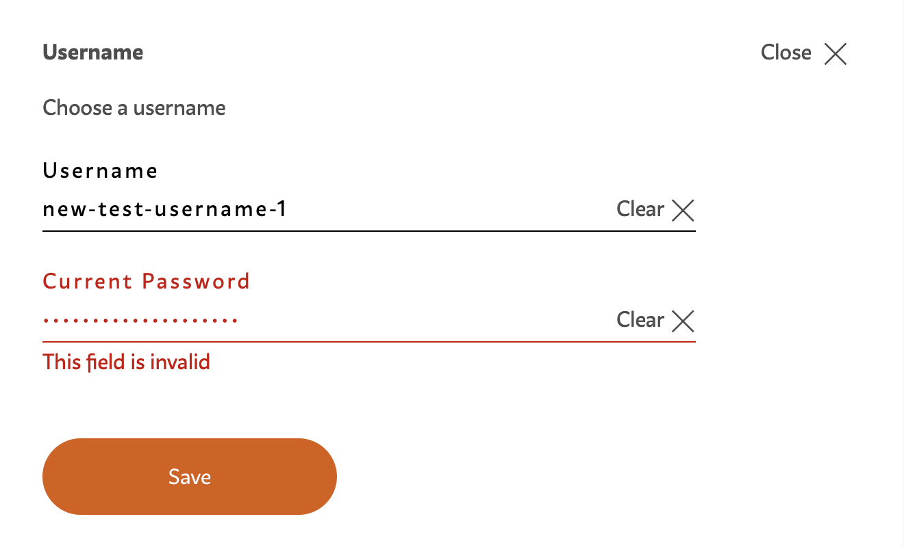
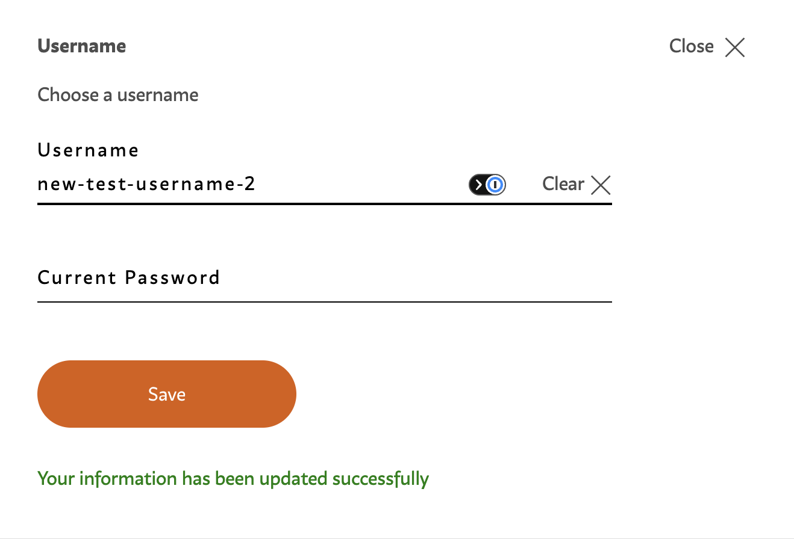
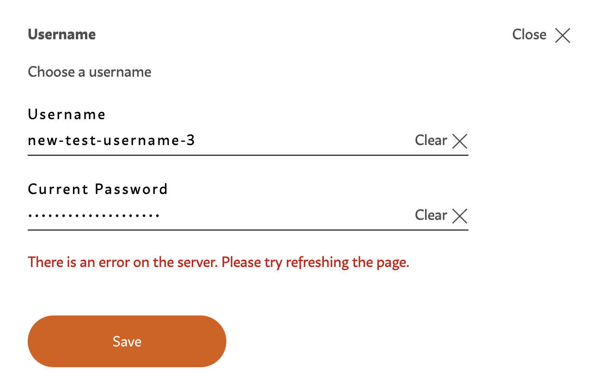
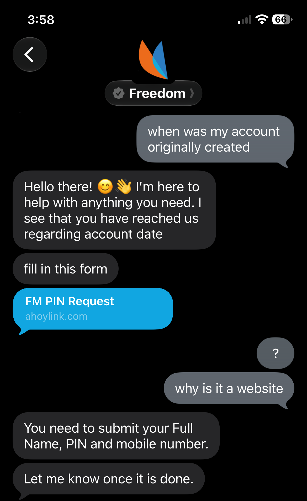

+++
draft = false
date = 2026-11-14T12:37:00-05:00
title = "Freedom Mobile's Authentication is a Mess"
description = ""
+++

I have been a Freedom Mobile customer since 2014, back when the company was still called Wind Mobile. Shaw bought Wind in 2016 and renamed it. A few years later Rogers bought Shaw, and regulators only cleared that deal on the condition that Freedom be sold off, so in 2023 it went to Quebecor's Videotron. Today Freedom is the fourth largest wireless carrier in Canada.

I recently tried to change my account's username on Freedom's self-serve site. It did not go well.

## Trying to change my username

The change-username form has two fields: a new username, and my current password. I filled in both and clicked save.


<div class="freedom-image">
    
</div>


No request was even sent. The rejection happens entirely in the browser. In DevTools I found that the form checks my current password against this regex:

```js
/^(?=.*?[A-Z])(?=.*?[a-z])(?=.*?[0-9])(?=.*?[@$#!%*?&(){}:,+_=;]).{8,32}$/
```

That is the pattern for choosing a new password: 8 to 32 characters, with an uppercase letter, a lowercase letter, a digit, and a symbol. It is being used to check the password I already have. My account is old and my password is simpler than that.

Alas, I can overwrite the regex using the debugger.

```http
PUT /api/v1/authentication/user-name/update-username HTTP/1.1
authorization: Bearer <redacted>
currentPassword: <redacted>
msisdn: 5XXXXXXXXX
newUsername: new-test-username-2
```

> The form fields are sent as request headers, not the body, which already seems strange.

The server returned 204 No Content, and the page showed a green success message.

```http
HTTP/1.1 204 No Content
TraceId: 1-6af764d7-214038a34171aca97678b4a0
```


<div class="freedom-image">
    
</div>


Unfortunately, after logging out and trying to log back in with my new username, I quickly realized that my username was, in fact, not updated. My username stayed the same, and the profile endpoint still returned the old one. The server reported a write it seemingly never made.

Then I sent the same request again:

```http
HTTP/1.1 409 Conflict
TraceId: 1-6af765a0-617bb7452b8f5d62477b6baa

{
    "status": "Conflict",
    "errors": [
        {
            "code": "UsernameDoesNotExist",
            "description": "This user name does not exist in our system."
        }
    ]
}
```


<div class="freedom-image">
    
</div>


This time it returned 409 Conflict, with the code `UsernameDoesNotExist`. From this stage, no matter what username I tried to set, I always received a 409.

Somewhere along my exploration I had accidentally leaked my password to Claude. Thus, I tried to change my password through the change-password form. It returned the exact same 409 `UsernameDoesNotExist`. The only thing that worked was resetting my password through the "forgot password" email flow. And that is when the loop showed itself: right after a reset, the next username change returns 204 and still changes nothing, and every attempt after it returns 409.

So the whole thing is a useless loop:

```text
reset password through "forgot password" email flow
   |
   v
attempt to change username and receive false positive 204
   |
   v
attempt to change username and receive 409 (every attempt after)
   |
   +--> loop
```

## The "new" login system

None of this is news to Freedom. When I called and asked why the site is broken, the agent was not surprised, and said a new login system is almost ready. The transcribed call:

> "The website is not working, but there is a new login method that we are launching soon, after maybe like a maximum of one month from now. So it's not ready yet to be published to the customers. That's why all the people right now only log in with phone number and pin codes and not with the other methods."

I also found out that having a username and password at all may be due to my account's legacy age, and that most accounts solely have a 4-digit PIN and their phone number instead of a username. Not that it matters for security, since you are only as safe as your most insecure path. A SIM swap walks straight through that path: port the number to a SIM the attacker controls, and the 2FA text codes arrive at them instead, leaving only 10,000 possible PINs to guess, which I can only hope are rate limited.

And the "new" system has been almost ready for a really long time... Three years ago, an official Freedom account [answered a customer](https://www.reddit.com/r/freedommobile/comments/18m2h7t/comment/krzvhba/) ([archived](https://web.archive.org/web/20261114172916/https://www.reddit.com/r/freedommobile/comments/18m2h7t/comment/krzvhba/)) who asked for exactly this:

> Hi u/Jonavin,
>
> thank you for the feedback, but let me reassure you, this topic was on my radar already. Our IT team is actively working on evolving the login process and requirement to better best practices. Some changes should be coming in the upcoming months.
>
> Best,
>
> JP

## An aside: conditioning users to be phished

While writing this post, I contacted Freedom via their official text support through Apple Messages for Business. The agent told me to "fill in this form" and sent me a link to **ahoylink.com**, asking for my full name, PIN, and mobile number.


<div class="freedom-image-tall">
    
</div>


ahoylink.com is not a Freedom domain. It is also not Apple's built-in Business Chat form, which exist precisely so a company can collect this sort of information inside the secure Messages thread. Instead, Freedom's own verified support account is teaching its customers to type their account PIN into a random website. That is indistinguishable from a phishing attack, and reckless by definition through conditioning users to similarly presented attacks.

In fact, at first I thought that the support agent was compromised and this was a personal link they made. Two years ago another customer posted the same kind of link and asked, ["There's no way this is a legit link is it?"](https://www.reddit.com/r/freedommobile/comments/1fte6zk/theres_no_way_this_is_a_legit_link_is_it/) ([archived](https://web.archive.org/web/20241213013246/https://www.reddit.com/r/freedommobile/comments/1fte6zk/theres_no_way_this_is_a_legit_link_is_it/)). The top reply confirmed it was real, then added:

> definitely looks shady as fuck, I wish Freedom had a better system.

## Conclusion

I was never able to change my username.

- The change-username form checks my current password with the rule for a new one, so my real password is rejected before any request is even sent.
- Bypass that, and the server returns a false positive 204 success that changes nothing, then 409 `UsernameDoesNotExist` on every attempt after, for an account I am logged into.
- Every customer is forced to maintain a four-digit PIN and SMS 2FA, which a SIM swap seems well positioned to bypass.
- Freedom's own verified support tells you to type your PIN into a random, non-Freedom website.
- The fix has been "coming in the upcoming months" for three years.

I find it baffling that a company of this size (and a telecom company at that) can get away with such neglect. Unfortunately, I am not holding my breath for Freedom to migrate to real passwords, TOTP, and passkeys.
